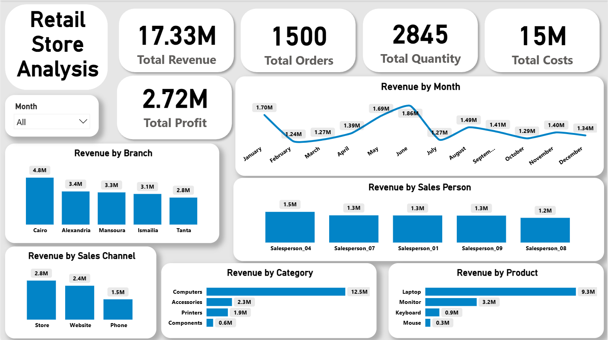

# 📊 Enterprise Retail Performance & Financial Analyst | Power BI Dashboard

> A comprehensive, corporate-grade two-page Power BI dashboard built as part of the **NGI Data Internship** (Ongoing). This project delivers deep commercial insights, revenue tracking, financial analysis, and operational metrics for retail store performance.

---

## 📂 Repository Structure & Project Files

This repository contains all necessary resources to run, review, and interact with the project:

- 📊 **Interactive Power BI Report:** [`NGI InternShip.pbix`](./NGI%20InternShip.pbix) *(Download & open in Power BI Desktop for full interactivity)*
- 📂 **Dataset:** [`data_detective_sales_training.csv`](./data_detective_sales_training.csv) *(Raw retail sales dataset)*
- 💻 **SQL Analysis Script:** [`Data_Detective_NGI.sql`](./Data_Detective_NGI.sql) *(Complete SQL queries used for data extraction and analysis)*
- 🖼️ **Executive Dashboards:** High-resolution preview screenshots included below.

---

## 📌 Project Overview
This project focuses on transforming raw retail data into actionable, executive-level insights using **Microsoft Power BI** and **DAX**. The solution is structured into two meticulously designed pages following a minimalist, clean, and modern corporate aesthetic (Corporate Blue theme) to optimize space usage and visual flow.

---

## 📊 Dashboard Preview

Below are high-resolution snapshots of the interactive **Power BI** dashboard pages:

### 1️⃣ Page 1: Overview (`Overview`)
- **Focus:** Commercial performance, top-line revenue, and sales drivers.
- **Key Metrics (KPI Cards):** `Total Revenue`, `Total Orders`, `Total Quantity`, `Total Costs`, and `Total Profit`.

---

### 2️⃣ Page 2: Financial Analyst (`Financial Analyst`)
- **Focus:** Financial health, operational insights, returns, and cost analysis.
- **Key Metrics (KPI Cards):** `Total Returned`, `Return Rate %`, `Profit Margin %`, and `Total Discounts`.

---

## 🔍 Data Detective Challenge: Business Answers & Insights

As part of the analysis, the retail dataset was thoroughly explored using SQL and analytical frameworks to answer critical business questions:

### Part 1: Understand the Data
- **Total Orders:** 1,500 Orders
- **Branches:** 5 Branches (*Cairo, Alexandria, Mansoura, Tanta, Ismailia*)
- **Product Categories:** 4 Categories
- **Total Products:** 8 Products
- **Sales Channels:** Store (645), Website (550), Phone (305)
- **Customer Types:** New (651), Returning (640), Corporate (209)

### Part 2: Sales Performance
- **Total Net Revenue:** 17,334,001.34
- **Total Profit:** 2,717,501.32
- **Top Branch (Net Revenue & Profit):** Cairo
- **Top Product (Net Revenue & Profit):** Laptop
- **Top Category:** Computers
- **Top Salesperson:** Salesperson_04

### Part 3: Discounts & Profitability
- **Average Discount Percentage:** 9.74%
- **Product with Highest Average Discount:** Headset
- **Orders with >15% Discount:** 183 Orders
- **Branch with Highest Average Discount:** Cairo
- **Product with Lowest Profit Margin:** Laptop

### Part 4: Customers & Sales Channels
- **Top Sales Channel (Revenue & Profit):** Store
- **Customer Comparison:** Returning Customers generate more revenue (7,807,735) compared to New Customers (7,591,302).
- **Branch with Highest Returning Customer Pct:** Alexandria (44.84%)

### Part 5: Returns & Delivery
- **Overall Return Rate:** 4%
- **Branch with Highest Return Rate:** Cairo (6.92%)
- **Product with Highest Number of Returns:** Laptop (13 returns)
- **Average Delivery Time:** 2 Days (Cairo leads with ~3 Days)

---

## 🧠 Part 6: Business Questions & Strategic Recommendations

### 32. Which branch should management focus on improving? Why?
> **Tanta Branch** should be the primary focus for improvement because it generates the lowest total revenue and quantities sold compared to other branches, indicating weak commercial performance and an immediate need for marketing and operational support. While Cairo generates the highest revenue, it suffers from the highest return rate (6.92%), but Tanta takes top priority for overall sales recovery.

### 33. Which product should the company promote more? Why?
> **Mouse** should be promoted more aggressively. Despite generating the lowest total profit (120,283) and revenue (311,783) among all products, it maintains one of the lowest return rates (2.35%). This proves the product has stable and acceptable quality among customers but suffers from a lack of sales volume and marketing push, presenting a great opportunity for profit growth.

### 34. Where do you see a possible problem with discounts?
> The issue is clearly visible in the **Mouse** product category. It receives an excessively high average discount of up to 23.3%, yet yields the lowest profit and revenue. Because its base price is low, heavy discounting erodes the thin profit margin without generating meaningful financial returns for the company.

### 35. Is the Website performing better than physical stores?
> **Physical Stores outperform the Website.** Stores dominate in terms of net revenue and profit, whereas the Website holds a smaller share of the overall financial value, even though traffic/quantities are relatively close.

### 36. What is one problem you discovered from the data that management may not notice immediately?
> **Cairo Branch's Operational Inefficiency:** Management might assume Cairo is the top performer due to its high revenue (4.78M). However, deeper analysis reveals it suffers from the highest return rate (6.92%) and the slowest delivery time (~3 days). This indicates its growth is driven purely by market size rather than customer satisfaction, posing a risk to future profitability if delivery and quality issues go unaddressed.

### 37. Give 3 recommendations to management based on your analysis.
1. **Optimize Delivery Times:** Streamline logistics, especially in high-volume branches like Cairo, to boost customer satisfaction and reduce return rates caused by delivery delays.
2. **Enhance Digital Marketing:** Launch targeted campaigns and online-exclusive promotions to drive web traffic and increase the Website's sales contribution alongside physical stores.
3. **Restructure Discount Policies:** Avoid heavy discounting on low-priced items (such as Mice) to protect thin profit margins from erosion and ensure sustainable financial yields.

---

## 🛠️ Tools & Technologies Used
- **Microsoft Power BI Desktop:** Data modeling, custom visual formatting, and visual storytelling.
- **SQL Server / BigQuery:** Database querying and exploratory data analysis (refer to [`Data_Detective_NGI.sql`](./Data_Detective_NGI.sql)).
- **DAX (Data Analysis Expressions):** Implemented advanced financial metrics and calculated columns.
- **Power Query:** Data cleaning, transformation, and shaping.
- **Git & GitHub:** Version control, project structure, and professional documentation.

---
*Developed by **Yahia Farag** as part of the **NGI Data Internship**.*
